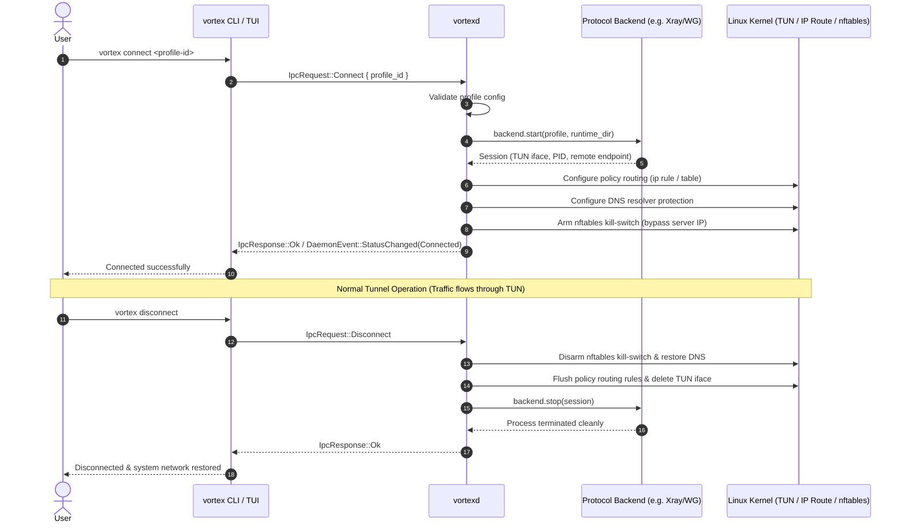

# Vortex Architecture & System Design

Vortex is a terminal VPN and proxy manager engineered for Linux systems (specifically Arch / Omarchy), written in asynchronous Rust (`tokio`, `ratatui`).

---

## 1. High-Level Workspace Architecture

The system is organized as a Cargo workspace with three crates:

```mermaid
graph TD
    User([User / Shell]) --> Client[vortex CLI & TUI (clap / ratatui)]
    
    subgraph "Unprivileged Client Domain"
        Client
    end
    
    subgraph "Inter-Process Communication"
        UDS["/run/vortex/vortex.sock<br/>Mode: 0660 (Group: vortex)<br/>JSON-RPC Frame Protocol"]
    end
    
    Client <-->|UDS Requests / Events| UDS
    
    subgraph "Privileged System Daemon (vortexd)"
        UDS <--> IPC[IPC Server & Dispatcher]
        IPC --> CoreMgr[Core & Backend Manager]
        IPC --> NetMgr[Network & Routing Engine]
        IPC --> ShieldMgr[nftables Kill-Switch Engine]
        IPC --> ProbeMgr[Health Probe & Failover Engine]
    end

    subgraph "Protocol Backends & Network Stack"
        CoreMgr --> Xray["Xray-core Backend (VLESS/Reality/WS/gRPC/VMess/Trojan/SS)"]
        CoreMgr --> WG["WireGuard Backend (Kernel / netlink)"]
        CoreMgr --> OVPN["OpenVPN Backend (Subprocess + Mgmt)"]
        CoreMgr --> HY2["Hysteria2 Backend"]
        CoreMgr --> AWG["AmneziaWG Backend"]
        
        NetMgr --> TUN["TUN Device (tun0 / vortex0)"]
        NetMgr --> PolicyRoute["Linux Policy Routing (ip rule / table 51820)"]
        ShieldMgr --> NFT["nftables (table inet vortex)"]
    end

    subgraph "Shared Library (vortex-core)"
        CoreTypes["Data Models & Configs"]
        Parsers["Link & Subscription Parsers"]
        CryptoStorage["Encrypted Storage (age / Argon2id)"]
    end

    Client -.-> CoreTypes
    vortexd -.-> CoreTypes
```

---

## 2. Workspace Crates

### `vortex-core`
- **Purpose**: Shared library providing core domain models, protocol abstractions, encryption, and IPC frames.
- **Components**:
  - `model`: Shared types (`Profile`, `Kind`, `Transport`, `Security`, `Auth` with `Zeroize`, `ActiveFlow`).
  - `error`: Strongly typed error hierarchy using `thiserror::Error`.
  - `ipc`: Protocol framing, length-prefixed JSON serialization, `IpcRequest`, `IpcResponse`, and `DaemonEvent`.
  - `backend`: Unified `Backend` trait for all protocol engines.
  - `backends`: Specialized backend implementations (`WireGuard`, `OpenVPN`, `Hysteria2`, `AmneziaWG`).
  - `xray`: Xray-core dynamic installer, SHA-256 verifier, JSON generator, and stats reporter.
  - `tunnel`: Virtual TUN lifecycle, routing table configuration, and teardown management.
  - `shield`: `nftables` atomic kill-switch ruleset generator and idempotent rollback.
  - `crypto` & `storage`: `age` encryption with Argon2id passphrase derivation and secret zeroization.

### `vortexd`
- **Purpose**: System-level daemon running as a systemd service (`vortexd.service`).
- **Privilege Boundary**:
  - Drops full root privileges where possible, bounding capabilities to `CAP_NET_ADMIN` and `CAP_NET_RAW`.
  - Manages the privileged Unix domain socket at `/run/vortex/vortex.sock` (mode `0660`, owned by group `vortex`).
  - Safely monitors background backend processes and handles clean exit hooks (SIGTERM/SIGINT) to prevent network blackholes.

### `vortex` (CLI & Interactive TUI)
- **Purpose**: Combined command-line interface and full-screen terminal user interface (`ratatui`).
- **Modes**:
  - **CLI Subcommands**: Scripting and automation (`add`, `list`, `up`, `down`, `toggle`, `status`, `pick`, `shield`, `route`, `ping`, `doctor`, `completion`, etc.).
  - **Interactive TUI**: When invoked with no subcommand (`vortex`), launches the interactive full-screen dashboard with Omarchy theme detection, live telemetry, spectrum charts, active socket flows, subscription management, and node switching. Communicates with `vortexd` over IPC.

---

## 3. Tunneling, Routing & Teardown Lifecycle



---

## 4. Teardown Safety & Crash Recovery

To ensure the host network is never left broken or inaccessible:
1. **Idempotent Cleanup**: On startup, `vortexd` scans for stale network devices (`tun0`, `vortex0`) and orphaned `nftables` tables (`table inet vortex`), safely flushing them.
2. **Signal Trapping**: `tokio::signal::unix` handlers catch `SIGINT`, `SIGTERM`, and `SIGHUP`. The cleanup procedure runs before process termination.
3. **Panic Hook**: Custom panic hooks ensure that route teardown and firewall disarmament execute even in unforeseen panic conditions.
