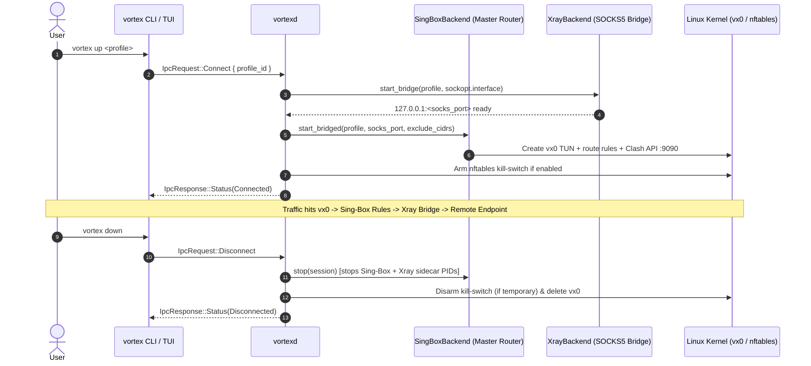

# Vortex Architecture & System Design

Vortex is a terminal VPN and proxy manager engineered for Linux systems (specifically Arch / Omarchy), written in asynchronous Rust (`tokio`, `ratatui`).

---

## 1. High-Level Workspace Architecture

The system is organized as a Cargo workspace with three crates:

```mermaid
graph TD
    User([User / Shell]) --> Client[vortex CLI & TUI (clap / ratatui)]
    
    subgraph "Unprivileged Client Domain"
        Client
    end
    
    subgraph "Inter-Process Communication"
        UDS["$XDG_RUNTIME_DIR/vortex.sock or /run/vortex/vortex.sock<br/>JSON-RPC Frame Protocol"]
    end
    
    Client <-->|UDS Requests / Events| UDS
    
    subgraph "Daemon (vortexd)"
        UDS <--> IPC[IPC Server & Dispatcher]
        IPC --> CoreMgr[Backend Resolver & Core Orchestrator]
        IPC --> NetMgr[Network & Routing Engine]
        IPC --> ShieldMgr[nftables Kill-Switch Engine]
        IPC --> ProbeMgr[Health Probe & Failover Engine]
    end

    subgraph "Protocol Backends & Network Stack"
        CoreMgr --> Bridge["ThroneBridgeBackend (SingBox Master Router -> Xray SOCKS5 Bridge)"]
        CoreMgr --> SingBox["SingBoxBackend (Hysteria2 / TUIC / Custom Sing-Box)"]
        CoreMgr --> Xray["XrayBackend (Standalone TUN Fallback / XHTTP / XDrive / PQ / CustomConfig)"]
        CoreMgr --> WG["WireGuardBackend (wg-quick)"]
        CoreMgr --> AWG["AmneziaBackend (awg-quick)"]
        CoreMgr --> OVPN["OpenVpnBackend (openvpn subprocess)"]
        
        Bridge --> TUN["TUN Device (vx0) + Clash API (:9090)"]
        SingBox --> TUN
        ShieldMgr --> NFT["nftables (table inet vortex)"]
    end

    subgraph "Shared Library (vortex-core)"
        CoreTypes["Data Models (CoreEngine / ProfilePayloadKind / RulesConfig)"]
        Parsers["Unified Lossless Parsers (parser.rs)"]
        CryptoStorage["Encrypted Storage (age / Argon2id)"]
    end

    Client -.-> CoreTypes
    vortexd -.-> CoreTypes
```

---

## 2. Workspace Crates

### `vortex-core`
- **Purpose**: Shared library providing core domain models, protocol abstractions, lossless parsers, encryption, and IPC frames.
- **Components**:
  - `model`: Shared types (`Profile`, `CoreEngine`, `ProfilePayloadKind`, `Kind`, `Transport`, `Security`, `Auth` with `Zeroize`, `ActiveFlow`).
  - `error`: Strongly typed error hierarchy using `thiserror::Error`.
  - `ipc`: Length-prefixed JSON protocol (`IpcRequest`, `IpcResponse`, `DaemonEvent`).
  - `backend`: Unified `Backend` trait + `resolve_backend` / `resolve_backend_for_session`.
  - `backends`: Modular backends (`SingBoxBackend`, `ThroneBridgeBackend`, `WireGuardBackend`, `AmneziaBackend`, `OpenVpnBackend`, `Hysteria2Backend`).
  - `xray`: `XrayBackend` (SOCKS5 bridge sidecar & standalone TUN fallback), Xray JSON config builder (with lossless `CustomConfig`), binary installer & SHA-256 verifier.
  - `parser` & `routing`: Single-source-of-truth config parsers (`Standard`, `CustomOutbound`, `CustomConfig`) and `RulesConfig` (`rules.toml`).
  - `tunnel`: Session lifecycle orchestrator, interface telemetry, Clash API / sysfs / Xray stats integration, and teardown.
  - `shield`: `nftables` atomic kill-switch (`table inet vortex`) with idempotent rollback and runtime state in `active_run_dir()`.
  - `crypto` & `storage` & `store`: `age` encrypted persistence under `user_config_dir()`, subscription management, and compatibility facade (`store.rs`).

### `vortexd`
- **Purpose**: Background daemon (`vortexd.service`) executing tunnel & firewall operations asynchronously (`spawn_blocking` workers), health monitoring, and traffic history accounting.
- **IPC Socket**: Listens on `$XDG_RUNTIME_DIR/vortex.sock` (or `/run/vortex/vortex.sock` when run as root).

### `vortex` (CLI & Interactive TUI)
- **Purpose**: Combined CLI (`vortex up/down/add/sub/route/shield/recon/flows/...`) and interactive `ratatui` TUI communicating with `vortexd` over IPC (no `sudo` required when `vortexd` is running or file capabilities / Proxy mode allow).

---

## 3. Tunneling, Routing & Teardown Lifecycle



---

## 4. Teardown Safety & Crash Recovery

To ensure the host network is never left broken or inaccessible:
1. **Idempotent Cleanup**: On startup, `vortexd` scans for stale network devices (`tun0`, `vortex0`) and orphaned `nftables` tables (`table inet vortex`), safely flushing them.
2. **Signal Trapping**: `tokio::signal::unix` handlers catch `SIGINT`, `SIGTERM`, and `SIGHUP`. The cleanup procedure runs before process termination.
3. **Panic Hook**: Custom panic hooks ensure that route teardown and firewall disarmament execute even in unforeseen panic conditions.
