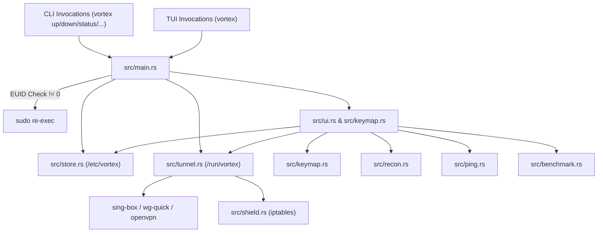

# Vortex Current State Architecture & Analysis

**Document Version:** 1.0.0  
**Repository:** `vortex` (Rust, Linux)  
**Date:** 2026-09-30  

---

## 1. Overview

Vortex is a terminal-based VPN and proxy manager tailored for Linux (specifically Omarchy / Arch-based environments). It provides an elite cyber-warfare terminal aesthetic built on `ratatui` and `crossterm`, utilizing `sing-box` as its primary universal core for modern proxy protocols alongside native support for WireGuard (`wg-quick`), AmneziaWG (`awg-quick`), and OpenVPN (`openvpn`).

Currently, the project is structured as a monolithic single-binary crate (`vortex`), which automatically attempts to elevate privileges via `sudo` when commands requiring network modification or interface creation are issued.

---

## 2. Existing Modules & Architecture

The codebase currently resides entirely under `src/` in a single crate:

### 2.1 `src/main.rs` (CLI & Application Entry)
- **Role:** Handles CLI subcommands, argument dispatch, privilege escalation checks (`libc::geteuid() != 0` invokes `sudo`), and runs either headless subcommands or the TUI (`ui::run()`).
- **Commands:** `add`, `list`/`ls`, `up`, `ping`, `best`, `qr`, `conf`/`config`, `sub`, `update`/`sync`, `auth`, `rename`, `rm`, `proxy`, `shield`/`killswitch`, `recon`, `speed`/`benchmark`, `flows`, `route`, `down`, `status`.

### 2.2 `src/tunnel.rs` (Tunnel Management & Process Lifecycle)
- **Role:** Orchestrates tunnel startup, daemonization, runtime tracking, and teardown.
- **Protocols Supported:**
  - Sing-box core: VLESS (Reality, WS, gRPC), VMess, Trojan, Shadowsocks, Hysteria2, TUIC.
  - Native tools: WireGuard (`vxwg0`), AmneziaWG (`vxawg0`), OpenVPN (`tun0`/`tap0`).
- **Runtime State:** Stores active session data in `/run/vortex/session.json`, sing-box generated configurations in `/run/vortex/singbox.json`, and core logs in `/run/vortex/core.log`.
- **Flow Sniffer:** Queries sing-box Clash API at `127.0.0.1:9090/connections` with a fallback to parsing `ss -ntp state established`.
- **Routing & Proxy Bridge:** Spins up a local SOCKS5/HTTP mixed proxy bridge on `127.0.0.1:1080` and manages a minimal `/etc/vortex/routing.json` (LAN bypass and direct/blocked domain suffixes).

### 2.3 `src/store.rs` (Configuration Store & Format Parsers)
- **Role:** File-based profile and subscription management located in `/etc/vortex/` (root-owned).
- **Parsers:**
  - Share URLs: `vless://`, `vmess://` (Base64 JSON), `trojan://`, `ss://` (SIP002), `hy2://` / `hysteria2://`, `tuic://`, `vpn://` (Amnezia).
  - Raw configs: WireGuard (`.conf`), AmneziaWG (`.conf`), OpenVPN (`.ovpn`).
  - Remote Subscriptions: Base64-encoded or line-delimited subscription endpoints, with update tracking and node deduplication.
  - QR Code Generation: Unicode dense terminal rendering via `qrcode`.

### 2.4 `src/ping.rs` (Latency Measurement)
- **Role:** Measures profile reachability and RTT.
- **Mechanism:**
  - TCP handshake timing (`TcpStream::connect_timeout`) for TCP-based protocols.
  - ICMP Echo (`ping -c 1 -W 1`) for UDP protocols (Hysteria2, TUIC, WireGuard, AmneziaWG).

### 2.5 `src/recon.rs` (Deep Node Reconnaissance)
- **Role:** Detailed telemetry gathering on target nodes.
- **Metrics:** DNS resolution, reverse DNS PTR lookups, ASN / Org / GeoIP lookup via external HTTP APIs, TLS certificate extraction (subject, issuer, cipher suite), and multi-probe latency jitter calculation.

### 2.6 `src/shield.rs` (Kill-switch & Anti-leak Firewall)
- **Role:** Kill-switch implementation using `iptables`.
- **Rules:** Isolates outbound traffic to loopback (`lo`), tunnel interface (e.g. `vx0`), exempt server endpoint IP/port, and LAN subnets (`192.168.0.0/16`, `10.0.0.0/8`, `172.16.0.0/12`).
- **State:** Tracks status in `/run/vortex/shield.json` and user preference in `/etc/vortex/shield_enabled`.

### 2.7 `src/benchmark.rs` (Live Throughput Benchmark)
- **Role:** Bandwidth throughput testing under live load.
- **Mechanism:** Downloads chunks from public CDNs (Cloudflare, Cachefly, Hetzner) using `curl`, measuring MB/s, Mbps, and elapsed duration.

### 2.8 `src/keymap.rs` (Vim-friendly Mode-based Keybindings)
- **Role:** Decoupled input handling and key mapping.
- **Types:**
  - `Action`: Full enumeration of user commands.
  - `Mode`: `Normal`, `Search(String)`, `Confirm(ConfirmKind)`, `Help`, and active modal overlays.
  - `ConfirmKind`: `DeleteNode`, `QuitWhileConnected`.
  - `map_key`: Translates `crossterm::event::KeyEvent` into `Option<Action>`, ignoring release events and binding `Ctrl+C` to `ForceQuit` in all modes.
  - Help dictionary (`HELP_ENTRIES`) as single source of truth for bindings.
  - Custom overrides parser for `~/.config/vortex/keys.toml`.

### 2.9 `src/ui.rs` (Cyber Warfare Terminal UI)
- **Role:** Ratatui TUI drawing and event loop.
- **Panels:**
  - `[1] TARGET MATRIX`: Node list, protocol tags, ping, search filtering.
  - `[2] TELEMETRY`: Active connection graph, IP address, cipher, endpoint, uptime.
  - `[3] PACKET FLOW`: Live throughput sparklines, RTT jitter chart, or active socket flows.
- **Footer:** 8-hint context-aware status bar.
- **Modals:** QR display, subscription manager, deep recon report, throughput benchmark, safe exit prompt on `q` (`y` disconnect & quit, `b` background detach, `n` cancel).

---

## 3. Data Flow

---

## 4. Current Limitations & Technical Debt

1. **Monolithic Process Model:** The TUI and daemon are coupled into the same process. Closing the TUI requires special detached handling to prevent killing the tunnel.
2. **Elevated Privileges (`sudo` re-exec):** The whole binary re-executes via `sudo`, meaning configuration storage defaults to `/etc/vortex` rather than user-owned `~/.config/vortex/`.
3. **Storage Security:** Node configuration credentials, OpenVPN passwords, and private keys are stored in plaintext JSON in `/etc/vortex/profiles/`.
4. **Firewall Backend:** Kill-switch relies on legacy `iptables` rather than atomic modern Linux `nftables` tables and chains.
5. **Probing Inconsistency:** Node ping uses raw ICMP/TCP directly, while the live tunnel measures through the interface, creating latency metric discrepancies between the list view and telemetry view.
6. **No Daemon/Client Split:** There is no persistent Unix socket IPC service (`vortexd`) providing an event stream to multiple clients.

---

## 5. Migration Roadmap to Modular Architecture

- **Phase 1:** Workspace restructure into `vortex-core` (lib), `vortexd` (daemon), and `vortex` (client binary), with Unix domain socket IPC (`$XDG_RUNTIME_DIR/vortex.sock`).
- **Phase 2:** User-space configuration store (`~/.config/vortex/`), age-encrypted secrets at rest with `keyring` integration, comprehensive link parsers with error reporting.
- **Phase 3:** Multi-layer probing (TCP, TLS, real HTTP delay through node), rolling statistics (median, jitter, loss), auto-selection, and failover engine.
- **Phase 4:** Atomic `nftables` kill-switch table, IPv6 leak protection, crash recovery, and automated leak verification.
- **Phase 5:** Full rule-set engine (domains, GeoIP, GeoSite, CIDR, process name/cgroup), hot-reloading routing rules, and `explain route`.
- **Phase 6:** Observability, persisted traffic history (SQLite), structured `tracing` logs with live TUI viewer and log rotation.
- **Phase 7:** Complete `clap` CLI with `--json` outputs, shell completions, and man pages.
- **Phase 8:** Enhanced mode-based TUI client communicating strictly via daemon IPC.
- **Phase 9:** Tests, CI workflows, benchmarks, and thorough documentation.
